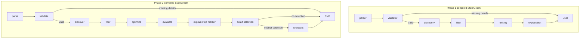
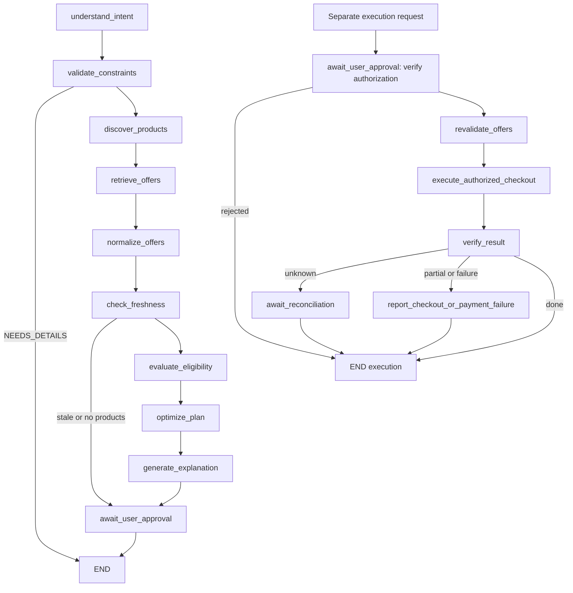

# IntentOS — independent Phase 1–3 functional audit

Audit date: 2026-11-06 (Asia/Calcutta). Audited application commit: `74c968391477ccdaf02959b0d25e7b3a4113dbbb`.

Scope: the **current repository's Phase 1–3 functionality**, not an archived checkout. Phase 4 was already present before this request. This audit did not implement Phase 4, change production behavior, or remove existing functionality. Additions are audit tests, an explicitly labeled test-only UI harness, reports and screenshots. The full test run also includes the pre-existing finance tests.

## A. Executive Summary

**Overall readiness: NOT READY for an unqualified Phase 1–3 functional/financial-safety sign-off.** This is a substantially working local demo, not a fake application. Its real LangGraph orchestration, real OR-Tools optimization, database-backed demo catalog and mock payment flows executed successfully. However, a reproduced Phase 1 approval-binding defect remains, live Gemini execution is unverified, and production/database deployment acceptance has not been completed.

Strengths:

- The original 158 tests passed. With audit probes added, the final suite returned **162 passed, 3 strict expected failures**, with no ordinary skips. Disabling expected-failure handling reproduced all three defects as actual test failures; these are not fixed or dismissed as passing behavior.
- Browser execution reached PAID for a single-product order and a five-item order, and completed a three-merchant captured-timeout → reconciliation → resume sequence with one attempt per merchant.
- Phase 2 and Phase 3 use genuine CP-SAT models, not hardcoded returned baskets. Existing tests include an exhaustive-search comparison for a small optimization instance.
- Phase 3 has exact Decimal landed costs, source/freshness gates, persistent planning checkpoints, approval digests, execution fencing, independent mock receipts, bounded retry and reconciliation.
- TypeScript checking, production build, dependency compatibility checks, Python compilation and npm's vulnerability advisory check passed.

Blockers and next action:

1. Fix AUD-002: bind the Phase 1 approved product/merchant/specification snapshot to execution, then rerun the strict regression without xfail.
2. Handle cross-phase session IDs and database outages deliberately (AUD-003/004).
3. Run credentialed Gemini and PostgreSQL/concurrency acceptance before claiming those integrations verified.
4. Preserve local-only deployment until authentication/ownership controls exist (AUD-001).

No real-money transaction was executed. Payment mode is **MOCK**, not sandbox or live.

## B. Feature Verification Matrix

WORKING means execution evidence exists for the stated scope. PARTIAL means a working subset with identified omissions. BLOCKED means external verification was unavailable. STUB identifies a contract/marker without the advertised external behavior. NOT IMPLEMENTED means no implementation was found. A source-only observation is not labeled WORKING.

| Feature | Status | Evidence | File/function | Test result |
|---|---|---|---|---|
| Phase 1 natural-language extraction using real Gemini | BLOCKED | Key absent; no live request issued | `services/gemini.py: GeminiService.parse` | Official-SDK fixture tests pass; live semantics unverified |
| Phase 1 hard/soft distinction and filtering | WORKING | Intel, >=16 GB, <=75000 hard checks; 1.4 kg remains soft | `services/optimization.py: eligible/rank` | `test_workflow.py`, audit hard/soft probe pass |
| Declared product source | WORKING | Database-backed demo catalog; synthetic sample configurations | `services/catalog.py: LocalCatalogProvider` | Catalog/API tests and browser execution pass |
| Phase 1 deterministic ranking | WORKING | Ordered recommendations; stable tie ordering | `services/optimization.py: rank` | Ranking tests pass; browser shortlist rendered |
| Phase 1 explanation grounding | PARTIAL | Backend renders allowed catalog facts from reason IDs; fixtures validate references | `services/gemini.py: explain` | Grounding/rejected-ID tests pass; live reason selection unverified |
| Phase 1 order creation and persistence | WORKING | Pending order → approved → paid; saved order restored after reload | `services/orders.py` | API tests pass; browser paid INR 58500 |
| Phase 1 preapproval/duplicate-payment controls | WORKING | 409 before approval; duplicate behavior and amount-input rejection tested | `services/orders.py: pay` | Existing API tests and audit transitions pass |
| Phase 1 approval binding to seller/product terms | BROKEN | Seller changed after approval; payment still returned 200 PAID | `services/orders.py: verify_single` | AUD-002 strict xfail; unmasked failure |
| Phase 1 frontend/backend integration | WORKING | Input, intent fields, comparison, selection, approval, history, mock payment exercised | `frontend/src/app/page.tsx` | Browser with explicitly fixed AI fixture |
| Phase 1 invalid session-kind handling | BROKEN | Commerce session passed to single-session reader returns 500 | `api/routes.py: purchase` | AUD-003 strict xfail; unmasked failure |
| Phase 2 real AI multi-intent extraction | BLOCKED | Key absent; fixture only | `services/gemini.py: parse_multi` | Structured SDK fixture tests pass |
| Phase 2 category/quantity/mandatory validation | WORKING | Five categories, required quantities, optional all-or-none behavior | `models/multi_schemas.py`, `budget_optimizer.py` | Schema/optimizer/API tests pass |
| Phase 2 genuine OR-Tools optimization | WORKING | CP-SAT variables, cost constraint, objective, solve, no-good cuts | `services/budget_optimizer.py: optimize` | Exhaustive-search comparison and alternative tests pass |
| Phase 2 alternatives and allocation | WORKING | Browser totals INR 88300, 90400, 86500 within INR 100000 | `budget_optimizer.py: summarize` | Browser selected INR 90400 alternative |
| Phase 2 cart edit/version/checkout | WORKING | Quantity, eligibility, stock and version checks executed | `services/plans.py`, `bundle_checkout.py` | Multi API tests pass; browser created five-item order |
| Phase 2 mock approval/payment persistence | WORKING | Five OrderItems and paid order persisted | `services/orders.py`, `bundle_checkout.py` | Browser paid INR 90400; DB inspection confirms |
| Phase 2 replan and approval invalidation | WORKING | Changed budget/spec/stock replaces plan and cancels untouched authorization | `services/plans.py: replan/ensure_current` | `test_multi_api.py`, `test_plans.py` pass |
| Phase 2 dedicated explanation graph node | STUB | `explain` adds a completed-step label only; actual deterministic reasons are generated in summarize | `agents/multi_workflow.py: explain` | Graph executes; no separate reasoning/explanation work in this node |
| Phase 1/2 mid-planning interruption persistence | PARTIAL | Completed results saved, but failed planning is not checkpointed node-by-node | `api/routes.py: analyze`, `services/plans.py: generate` | Source review; no Phase 1/2 interrupted-planning resume acceptance |
| Provider abstraction | WORKING | Registry invokes providers, isolates failures, checks provenance | `commerce/providers.py: ProviderRegistry` | Provider tests pass |
| External provider contract | STUB | Abstract discovery/revalidation contract only | `commerce/providers.py: ExternalCommerceProvider` | No live implementation registered |
| Live merchant adapter | NOT IMPLEMENTED | Registry contains demo provider; provider endpoint reports pending | `commerce/store.py: registry_for` | Browser and API confirm demo-only mode |
| Offer normalization/provenance labels | WORKING | Schema validation; unauthorized live assertion rejected | `commerce/normalization.py` | Offer tests pass; browser labels demo sources |
| Product deduplication | WORKING | Normalized identity includes specifications; variants remain distinct | `ProductDeduplicationService` | Deduplication tests pass |
| Offer freshness/availability | WORKING | 15-minute lifetime, expiry, stock, source gates | `commerce/freshness.py` | Stale/unavailable tests pass; browser shows timestamps |
| Decimal landed costs | WORKING | Shipping/fees and confirmed discounts included; potential discounts excluded | `commerce/pricing.py` | Exact-money tests pass; browser quote table matches backend |
| Multi-merchant optimization | WORKING | CP-SAT uses current eligible offers and shared listing-stock constraints | `commerce/optimizer.py` | `test_offer_optimizer.py` passes; browser INR 90263.75 basket |
| Dynamic replanning/session memory | WORKING | Versioned session, merge updates, retained unrelated constraints | `commerce/sessions.py` | Workflow/API tests pass; browser creates version 2 |
| Phase 3 persistent planning/resume | WORKING | SQL JSON checkpoints and completed-node markers; AI failure leaves IDs for resume | `commerce/workflow.py` | Interruption/resume tests pass |
| Suborders/payment intents | WORKING | One parent, three merchant suborders/intents | `commerce/checkout.py` | Browser and DB inspection confirm |
| Exact-terms authorization | WORKING | Digest/approval/amount checks and stale-term invalidation | `commerce/payments.py: PaymentAuthorizationService` | Payment/API tests pass |
| Timeout/unknown-outcome handling | WORKING | Unknown stops dispatch and blocks blind retry | `PaymentExecutionService` | Automated tests pass; browser PAYMENT_UNKNOWN observed |
| Reconciliation/resume | WORKING | Independent provider ledger lookup, amount check and fenced resume | `PaymentReconciliationService` | Browser finishes with three attempts/three receipts |
| Partial failure/explicit retry/compensation | WORKING | Captured/failed/refund-pending/refunded remain distinct | `commerce/payments.py` | Payment/API tests pass; simulations only |
| Audit events/traces | WORKING | Persisted events, measured latency, allowlisted trace fields | `orders.event`, `commerce/tracing.py` | API/redaction tests pass; preview DB has 40 traces |
| Sandbox/live payment adapter | NOT IMPLEMENTED | Only mock gateways/providers exist; other configured modes rejected | `services/payments.py`, `commerce/payment_providers.py` | Mock-only guards inspected/tested |
| Database migrations | PARTIAL | SQLite upgrades and data-preserving downgrade guards executed | `migrations/versions/0001`–`0006` | Two migration tests pass; PostgreSQL blocked |
| Authentication/ownership controls | NOT IMPLEMENTED | Anonymous second client can read and approve an order | `main.py`, API dependencies | Observational audit test confirms local-only boundary |
| Controlled database-outage response | BROKEN | Failed SQLite connection returns unhandled 500, not controlled 503 | `db/session.py`, routes | AUD-004 strict xfail; unmasked failure |
| Frontend compilation/type checking | WORKING | All routes including existing finance page build | `frontend/package.json` | Typecheck/build pass |
| Frontend lint gate | NOT IMPLEMENTED | No lint script/configured lint command | `frontend/package.json` | `npm run lint` fails with Missing script |

## C. Actual Test Results

Commands below ran from repository root unless a working directory is specified. Test counts are **per run**, not added together.

| Exact command | Outcome | Results |
|---|---|---|
| `.\.venv\Scripts\python -m pytest -q -ra --junitxml=docs/validation/audit.xml` | PASS, exit 0 | Original suite: 158 passed, 0 failed/skipped; 44.07 s |
| `.\.venv\Scripts\python -m pytest -q -rxX backend/tests/test_audit_regressions.py --junitxml=docs/validation/audit-targeted.xml` | Known defects visible as strict xfail | First six-probe version: 3 passed, 3 xfailed; 9.48 s |
| `.\.venv\Scripts\python -m pytest -q --runxfail --tb=short backend/tests/test_audit_regressions.py --junitxml=docs/validation/audit-unmasked.xml` | FAIL, exit 1 | Expected-failure handling disabled: **3 failed, 4 passed**, 8.95 s |
| `.\.venv\Scripts\python -m pytest -q -rxX --junitxml=docs/validation/audit-final.xml` | Exit 0 with known failures marked | **162 passed, 3 xfailed, 0 ordinary skipped**, 75.23 s; 14 dependency deprecation warnings |
| `npm run lint` (frontend) | FAIL | `Missing script: "lint"`; no lint analysis executed |
| `npm run typecheck` (frontend) | PASS | `tsc --noEmit`; not a test-case count |
| `npm run build` (frontend) | PASS | Next.js webpack build and static routes `/`, `/setup`, `/commerce`, `/finance` plus not-found |
| `.\.venv\Scripts\python -m pip check` | PASS | No broken requirements found; **not** a vulnerability scan |
| `.\.venv\Scripts\python -m compileall -q backend/app` | PASS | Python compilation; not a functional test count |
| `npm audit --json` (frontend, saved to `docs/validation/audit-npm.json`) | PASS, exit 0 | Zero reported vulnerabilities in the evaluated dependency tree; 106 total dependencies |
| `.\.venv\Scripts\python -m pip_audit --version` | Unavailable | No module named `pip_audit`; Python advisory scan NOT RUN |
| `docker version` | Unavailable | Command not found; Compose/PostgreSQL runtime checks NOT RUN |

The final full suite contains 165 collected cases. Three are deliberately strict xfails for AUD-002/003/004. They are unresolved defects, not normal skips or fixes. The separate `--runxfail` run deliberately returns nonzero and exposes the assertions. XML files are local ignored validation outputs; the JSON report contains their summaries.

Confirmed regression responses:

- AUD-002: expected 409 after a seller change; observed **200**, payment status **PAID**, amount **58500** (mock).
- AUD-003: expected 404/422 for the wrong session kind; observed **500 Internal Server Error**.
- AUD-004: expected a controlled 503 during an induced unavailable SQLite connection; observed **500 Internal Server Error**.

The final audit adds seven probes: those three regressions, hard/soft/impossible/conflicting constraints, anonymous order access, invalid approval/payment transitions and a SQL-like identifier input. Production behavior was not altered to pass a probe.

Edge-case coverage:

| Required scenario | Executed evidence / outcome |
|---|---|
| Budget below all products | Workflow/optimizer and audit probe: no eligible product / infeasible plan |
| Conflicting hard constraints | Existing optimizer tests and audit RAM min/max conflict: no eligible result |
| Missing category | Schema/workflow/API tests: NEEDS_DETAILS or validation error |
| Out of stock | Optimizer and material-change tests: no selection or approval invalidation |
| Price changes after approval | Phase 1/2/3 tests reject payment; Phase 2/3 provide revised plan |
| Duplicate payment | Existing idempotency tests: no second attempt/charge |
| Payment before approval | Existing tests and new audit transition probe: 409 |
| Timeout | Phase 3 automated and browser captured-timeout case: PAYMENT_UNKNOWN then reconciliation |
| One merchant succeeds, another fails | Commerce API/payment tests: PARTIAL_FAILURE; no false all-paid result |
| Gemini failure | Official wrapper and API failure fixtures: explicit unavailable error, no fake fallback |
| Database failure | Induced SQLite I/O failure: reproduced 500 (AUD-004) |
| Resume after interruption | Phase 3 API failure/resume tests pass; Phase 1/2 limitation disclosed |
| Requirements change mid-session | Automated updates and browser portability update create new version |
| Duplicate offers/products | Deduplication and shared-stock optimizer tests pass |
| Stale offers | Freshness and changed-term API tests reject expired selection |

## D. Architecture Findings

Backend: FastAPI, Pydantic, SQLAlchemy and Alembic. Frontend: Next.js/React client components calling the API; result data are not hardcoded in the UI. Catalog: persisted demonstration JSON seed data. Optimization: OR-Tools CP-SAT. AI: official Google GenAI SDK. Orchestration: compiled LangGraph StateGraphs. Payments: local mock gateways/ledger.

Environment observed: Windows 11, Python 3.14.7, Node 24.19.0; FastAPI 0.162.0, SQLAlchemy 2.1.8, google-genai 1.75.0, LangGraph 1.2.20, OR-Tools 9.15.6755, Alembic 1.20.1, pytest 9.2.0, Next.js 16.4.5. Git branch `master`, clean at audit start, existing GitHub origin, configured Git identity preserved.

Required configuration: server-side `GEMINI_API_KEY`, `GEMINI_MODEL`, `DATABASE_URL`, `PAYMENT_MODE`; frontend `NEXT_PUBLIC_API_URL` is an API URL, not a secret. The database defaults target local PostgreSQL. Compose describes PostgreSQL 17 with a loopback port and named volume; bundled development credentials are not production credentials. Their values are intentionally omitted here.

Database domains include products/sessions/orders/payments/events; multi plans/carts/order items; merchant offers/sessions/plans/snapshots/suborders/payment intents/attempts/receipts/reconciliation/traces. Existing Phase 4 tables were included by migrations but not expanded in this audit.

Implemented workflows:

## E. Gemini Integration Findings

**Live Gemini: UNVERIFIED / BLOCKED by absent credentials.** Configured model is `gemini-2.5-flash`. Only key presence was inspected; no key was printed. No live request was sent when the key was absent.

`google.genai.Client` and `models.generate_content` are real official-SDK calls in production code. The wrapper sets JSON MIME type, response schema, temperature zero and a 30-second client timeout, then validates response text with Pydantic. SDK/schema failures become `AIUnavailable`; API handlers return an explicit unavailable response. There is no production fallback that silently substitutes fake AI intent.

Grounded explanations restrict the model to catalog-backed identifiers/reason IDs and render numeric/specification facts server-side. Tests reject invented reason types and unknown product references. This constrains fabricated product claims in rendered explanations. It does **not** prove real-language intent extraction is semantically correct: Gemini could still misunderstand a request or add a schema-valid requirement. Human review remains necessary.

Browser Phase 1/2 tests used `backend/tests/audit_ui_server.py`, a clearly declared test-only DI harness with **fixed intent fixtures**, not actual Gemini extraction. Phase 1 explanation text explicitly states `AUDIT FIXTURE (no live Gemini)`. The harness is never a production fallback; normal entry remains `app.main:app`.

## F. LangGraph Integration Findings

Real `StateGraph`, TypedDict state, nodes, conditional edges, compile and invoke are present and exercised. These are genuine graph executions, although nodes naturally call ordinary deterministic Python business functions. They should not be described as independently autonomous intelligent agents merely because they are graph nodes.

Phase 1 saves the completed result after graph invocation. Phase 2 saves completed planning state and can resume a completed selection via a separate checkout graph. Neither has durable per-node failed-planning recovery. Phase 3 adds application-managed SQL JSON checkpoints and completed-node markers; successful resume skips finished planning nodes. This is custom persistence, not a configured native LangGraph checkpointer or use of LangGraph's interrupt API.

The execution graph rechecks boundary nodes on each request. Safe resumption comes from durable purchase/attempt/provider records and idempotent payment services, not blindly skipping old execution nodes. Tests exercise interruption/resume, preference retention, stale-version rejection and a fenced late-worker callback. They do not establish real PostgreSQL multi-process concurrency guarantees.

Phase 2's `explain` node is a step marker. Meaningful deterministic explanations are generated by `budget_optimizer.summarize`; no extra LLM explanatory agent is implemented at that node. Phase 3's eligibility node also computes a list that the optimizer independently re-filters; it is redundant orchestration, not evidence of additional intelligence.

## G. Optimization Findings

Phase 1 ranks eligible products with a deterministic weighted heuristic; it does not use OR-Tools and does not claim a solver guarantee. Phase 2/3 genuinely build CP-SAT integer selection models with mandatory/optional quantity constraints, stock limits, budget bounds, utility objectives and no-good cuts for alternatives. A five-second solve limit and deterministic single-worker seed are configured. FEASIBLE and OPTIMAL are distinct returned solver states; a time-limited feasible basket is not proof of global optimality.

Phase 1/2 transaction money is whole-INR integer arithmetic. Floating-point utility scoring in those phases is separate from transaction sums. Phase 3 uses Decimal money and integer paise in CP-SAT, including shipping/fees/confirmed discounts. Unknown taxes are labeled unsupported, not silently claimed tax-free.

Inputs are demonstration catalog data, including product performance/quality scores. No real-world recommendation quality or savings was measured. Stock constraints apply within plans; inventory fulfillment/reservation across independent purchases is not a live merchant service.

## H. Payment Safety Findings

Verified mock controls: explicit JSON-boolean approval; no payment before approval; immutable execution request keys/modes; duplicate prevention; server-side totals; cancelled/rejected-state rejection; changed-price/stock invalidation; Phase 3 unknown-outcome blocking, reconciliation, explicit retry and compensation. Audit events/traces persist. No amount supplied by the browser overrides server totals.

**AUD-002 is an actual gap:** Phase 1 verifies current eligibility and price, but does not compare an approved merchant/specification snapshot. A seller mutation with unchanged product ID/price passes validation and charges the mock gateway. Phase 2/3 have stronger snapshot/change checks; their passing tests do not repair Phase 1's boundary.

Phase 1/2 gateways simulate immediate success/failure only. Durable external timeout/unknown-state orchestration is a Phase 3 capability. It would be unsafe to replace a legacy pure mock charge with a network gateway without adding that protocol. Real sandbox/live capture, provider authentication, webhooks and actual refunds are not implemented or verified.

Browser/DB evidence: legacy paid orders INR 58500 and INR 90400, two legacy payments, five OrderItems; one Phase 3 purchase INR 90263.75, three CAPTURED suborders, exactly three attempts and three mock receipts. The timeout first left Alpha captured and Beta unknown; reconciliation recognized Beta's receipt, then resume dispatched Gamma once. Forty traces were present after the observed workflow/update. Session version advanced to 2 without erasing the paid transaction.

## I. Frontend Integration Findings

Browser automation was available and executed actual UI controls against the isolated audit backend on loopback port 8010, with Next dev on 3000. Verified input, displayed hard/soft requirements, recommendations, comparison, alternative selection, allocation, cart creation, approval, mock payment, restored history, merchant provenance/cost table, timeout/reconciliation/resume and explicit preference replanning. No browser console errors were observed in the inspected flow.

The UI's busy states follow awaited API calls; completed workflow labels come from backend results, not fake timed stage animations. Initial example prompts and structured defaults are static defaults, not fabricated returned results. Phase 1 natural-language mode depends on external Gemini; it has no structured-input UI equivalent. Without a key its normal analysis path cannot complete.

After Phase 1 history restoration, the heading falls back to product ID (`demo-07`) rather than the original product name because analysis state is no longer loaded. Payment restoration itself worked. This is a minor UI observation, not evidence of a failed payment flow.

Screenshots use fixed fixture AI where applicable and demo/mock financial behavior:

- [Phase 1 restored paid order](docs/validation/audit-phase1-paid.jpg)
- [Phase 2 paid multi-item order](docs/validation/audit-phase2-paid.jpg)
- [Phase 3 paid merchant suborders after timeout reconciliation](docs/validation/audit-phase3-paid.jpg)

## J. Security Findings

- No authentication, user ownership or tenant boundary exists. A separate anonymous TestClient could read and approve another known order ID (AUD-001). This matches the declared local-only demo contract, but is a deployment blocker if exposed beyond that boundary. CORS is not authorization.
- Current tracked files were scanned for recognizable Google/GitHub/OpenAI-style keys and private-key headers: no matching files. No non-example environment file or database file is tracked. This is a bounded pattern scan, not proof that all Git history or every possible credential format is clean.
- Runtime configuration is server-side; frontend uses a public API-base URL. No API-key value was printed, committed or sent by this audit.
- Inspected query paths use SQLAlchemy parameters rather than concatenating user input into SQL. A SQL-like order ID probe returned 404 and did not disrupt the valid order. This is not exhaustive injection testing.
- Pydantic rejects extra money fields, malformed approval flags and unsupported data. Wrong session kinds still cause a response-validation 500 (AUD-003).
- Phase 3 traces allowlist safe scalar fields and record error types, not prompts or payment instruments. Redaction tests pass. General operational logging/error handling is less complete during database outages (AUD-004).
- Row-lock/CAS/fencing protections exist, but real PostgreSQL concurrent-process behavior was not tested. SQLite tests and a reentrant late-worker test are not a substitute for that acceptance run.
- Demo mutation/ledger-resolution endpoints are intentionally unauthenticated local testing tools. They must not be public production routes.
- npm reported zero known vulnerabilities for the evaluated tree. Python advisory scanning was unavailable. Neither statement is a comprehensive security certification.

## K. Missing or Fake Functionality

Explicit simulations: all current product configurations/prices/scores, generated merchant quotes, payment captures/failures/timeouts, receipt lookup and compensation are demo/mock. They are meaningfully implemented simulations, not live-commerce verification.

Missing: registered live merchant adapter, sandbox/live payment integration, authenticated user ownership, real fulfillment/inventory service and deployment-grade concurrency acceptance. Abstract external-provider contracts are not integrations.

Marker-only behavior: Phase 2 explanation graph node records a label; deterministic plan reasons are produced elsewhere. Phase 1/2 do not have interrupted mid-planning checkpoints comparable to Phase 3.

Unverified: real Gemini interpretation/explanation selection, PostgreSQL migration/runtime/concurrency, public deployment, live merchant/provider behavior. The audit AI fixture is test scaffolding and must never be presented as evidence of real Gemini operation.

## L. Prioritized Issues

### AUD-002 — P1 — Phase 1 approved terms do not bind the seller

- Reproduce: create a single-product order; approve; change `Product.data.seller` while preserving ID/price/eligibility; call `/orders/{id}/pay`. Observed 200 PAID (mock), expected fresh authorization.
- File: `backend/app/services/orders.py:33`, `verify_single`; legacy Order model lacks an immutable approved product/merchant snapshot.
- Evidence: strict regression `test_approved_single_order_rejects_changed_seller`; unmasked run fails on 200 versus 409.
- Fix: persist selected and approved material terms and a digest, revalidate them on approval/payment, invalidate authorization on change; preserve paid history. Test other material term changes too. Only the seller mutation was executed by this new probe.

### AUD-001 — P2 — No user authentication/ownership boundary

- Reproduce: obtain an order ID; use a separate anonymous client to GET it and POST approval. Both return 200.
- Files: `backend/app/main.py`, `backend/app/api/*`, database dependency/model ownership fields.
- Fix: keep the app local; before public exposure add authenticated principals, ownership checks, tenant isolation and restrictions on demo mutation endpoints. This is a documented local-development limitation, not a newly discovered bypass of an existing authentication system.

### AUD-003 — P2 — Wrong session kind returns HTTP 500

- Reproduce: create `/api/v1/commerce/sessions`; GET its session ID through `/api/v1/purchases/{id}`. The single-product response schema rejects the different result shape; observed 500.
- File: `backend/app/api/routes.py:37`, `purchase`, shared `PurchaseSession` domain.
- Fix: validate session kind and return 404/422 before constructing the single-product response. Apply equivalent type guards to all shared-session readers.

### AUD-004 — P2 — Uncontrolled database-outage response

- Reproduce: override the audit DB dependency with a SQLite URL whose parent directory does not exist; GET `/api/v1/products` using a client that captures server exceptions. Observed generic 500, expected a deliberate service-unavailable response.
- Files: `backend/app/db/session.py:8`, API exception handling; `/health` is only a basic liveness response, not a database readiness probe.
- Fix: safely handle database unavailability, ensure rollback/cleanup, return a controlled 503, and add separate readiness checks and sanitized operational diagnostics. Actual PostgreSQL outage/recovery remains untested.

### AUD-005 — P2 — Phase 1/2 incomplete interrupted-planning recovery

- Reproduce/design evidence: their analysis/planning graph invokes before the session/plan record is saved. An exception before completion prevents a per-node checkpoint from being persisted. Phase 2 checkout resumes only already-completed planning state.
- Files: `backend/app/api/routes.py: analyze`, `backend/app/services/plans.py:26`, `generate`; `backend/app/agents/multi_workflow.py`.
- Fix: if resumable planning is required across all phases, allocate the session first, checkpoint completed stages and expose explicit resume APIs, using Phase 3's tested approach. Do not advertise Phase 3's resume coverage as coverage for every earlier phase.

### AUD-006 — P3 — No configured frontend lint check

- Reproduce: `cd frontend; npm run lint` → Missing script: lint.
- File: `frontend/package.json`.
- Fix: configure a compatible linter and script/CI gate. Keep lint results separate from TypeScript and production-build results.

Severity counts: **P0 0; P1 1; P2 4; P3 1.** No real-funds P0 incident was observed. Unknown/external behaviors are not silently promoted to verified safety.

## M. Phase 4 Readiness

**NOT READY.** This verdict means the requested comprehensive Phase 1–3 sign-off is not yet justified, not that the local demo is nonfunctional. The reproduced Phase 1 authorization gap should be fixed before relying on a financial-decision layer to preserve approved purchasing terms. Live Gemini and PostgreSQL acceptance also remain missing.

Phase 4 already exists in the audited tree; this audit did not extend it. Recommended next work is remediation and verification of the existing foundation, not another feature expansion or rebuild. Continued isolated demo experiments are possible, but do not turn these results into a production/live-commerce readiness claim.

## N. Verification Limitations

- No Gemini key configured: live extraction, model availability/quota/connectivity and real explanation selection were not tested. Model name is configuration, not proof of a successful live call.
- Docker unavailable; PostgreSQL default runtime, real database outage recovery and concurrent-process guarantees unverified. Executed functional/migration tests use isolated SQLite.
- No live merchant or payment adapters exist to verify. All transactions were mocks; no real money moved.
- Python advisory scanner absent. npm's zero-advisory result is limited to the queried dependency tree and audit time.
- Browser runs used fixed AI fixtures for Phase 1/2 and structured inputs for Phase 3; they verify UI/transport/deterministic/backend integration, not natural-language semantics.
- No exhaustive fuzzing, penetration test, load test, real merchant stock reservation, full Git-history secret scan or public deployment assessment was performed.
- Audit tests include pre-existing Phase 4 tests when invoking the entire suite; feature conclusions here remain scoped to Phases 1–3.
- Automatic approval review temporarily blocked a follow-up command due to account usage limits. After the user requested continuation, tool access recovered; no safety check was bypassed. The completed command outcomes, including failures, are reported rather than inferred.

The machine-readable companion is [AUDIT_RESULTS.json](AUDIT_RESULTS.json). Audit changes are intended for one focused test/documentation commit using the existing remote and identity. No production source or dependency configuration is changed.
