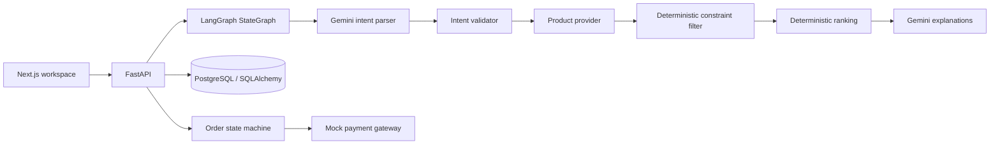

# IntentOS

A local agentic purchasing workspace that turns a natural-language laptop request into catalog recommendations and an explicitly approved **simulated** payment.

**Status:** Phase 1 implementation is runnable. Automated end-to-end API tests use mocked Gemini and SQLite. Live Gemini and PostgreSQL acceptance checks remain to be run with your local configuration. All products, specifications, performance scores and prices are synthetic demo data, not verified merchant offers.

## Start on Windows PowerShell

Prerequisites: Python 3.14 (tested), Node.js 24 (tested), Docker Desktop with Compose, and a Gemini API key. Run these commands from the repository root unless shown otherwise.

```powershell
python -m venv .venv
.\.venv\Scripts\python -m pip install -r backend/requirements.lock.txt
docker compose up -d db
Copy-Item backend/.env.example backend/.env
Copy-Item frontend/.env.local.example frontend/.env.local
```

Edit `backend/.env` locally and set `GEMINI_API_KEY`. Never commit this file. Keep `PAYMENT_MODE=mock`. The default database URL matches the local Compose service; its credentials are disposable local development values, not production credentials.

Backend terminal:

```powershell
Set-Location backend
..\.venv\Scripts\python -m alembic upgrade head
..\.venv\Scripts\python -m app.services.catalog
..\.venv\Scripts\python -m uvicorn app.main:app --host 127.0.0.1 --port 8000
```

Frontend terminal, starting from the repository root:

```powershell
Set-Location frontend
npm ci
npm run dev
```

Open [the purchase workspace](http://127.0.0.1:3000) and [interactive API documentation](http://127.0.0.1:8000/docs). Both servers bind to loopback. If port 8000 is occupied, use `--port 8010` and set `NEXT_PUBLIC_API_URL=http://127.0.0.1:8010` in `frontend/.env.local`, then restart Next.js.

Docker is not installed in the development session used to build this project. For a local SQLite run instead, set the following **in the backend terminal before migrations and server startup**:

```powershell
$env:DATABASE_URL="sqlite:///./intentos.db"
```

SQLite is for local development and tests. PostgreSQL is the intended database. Do not infer PostgreSQL locking or concurrency verification from passing SQLite tests.

## Try the acceptance scenario

Enter:

> Find me the best laptop under ₹75,000 for coding and AI development. Intel processor, at least 16 GB RAM, lightweight, and good battery life.

1. Analyze the request. Gemini must be configured; missing keys, unavailable service, invalid structured output or API errors return HTTP 503 without fabricated recommendations.
2. Inspect the top three products, normalized score components and catalog specifications. Use **Compare products** for a table.
3. Select a product to create a server-priced pending order.
4. Check the explicit approval checkbox and approve the order.
5. Choose whether to simulate failure, then execute the mock payment.
6. Inspect transaction ID, persisted status and audit history. Recent order IDs are kept in browser local storage; order and payment records are stored in the database. Reopen an order to restore its transaction result.
7. Try an impossible budget, such as one rupee: expect `NO_MATCH`, an empty recommendation list and no suggested substitute that violates mandatory constraints.

Missing essential information or unsupported categories/currencies returns `NEEDS_DETAILS`. Correct the request and analyze again. The supported category is laptop; currency is INR. Requests are sent to Gemini for parsing, and the top three catalog records are sent for explanations. Do not include personal or financial secrets in purchase requests.

## Architecture



- `agents/workflow.py` owns the six-node typed graph. Missing details stop discovery. Products cannot enter ranking unless they pass the deterministic filter.
- `services/gemini.py` uses the official `google-genai` SDK with Pydantic structured output for intent and explanations. Gemini selects catalog reason IDs; the backend renders only their exact verified values. Product IDs must exactly match eligible recommendations. No free-form model prose is accepted as product evidence.
- `services/catalog.py` defines the product-provider interface and database-backed demo implementation. The seed command is idempotent and does not overwrite existing catalog edits.
- `services/optimization.py` separates mandatory requirements from soft preferences. Supported rules are equality, numeric minimum and numeric maximum over processor brand, RAM, weight, storage, battery, GPU and OS. Availability, currency and budget are always checked.
- `services/orders.py` owns approval, cancellation, price/availability revalidation, idempotency and audit persistence. Catalog verification uses PostgreSQL row locks; conditional updates gate order transitions.
- `services/payments.py` defines a gateway interface and a pure mock implementation. No LLM path authorizes or executes payments.
- SQLAlchemy models cover products, purchase sessions, orders, payments and audit events. Alembic has an explicit, frozen initial schema. Request text, parsed intent, steps and recommendations are persisted with the session.

### Scoring

The weighted score is `100 × sum(component × weight)`. Components are clamped to 0–1: demo performance / 100; value = 1 − price / budget; portability = (3 − weight in kg) / 2; battery estimate / 15; preferences = fraction of satisfied soft rules, or 0.5 when none exist.

General weights: performance 30%, value 20%, portability 15%, battery 15%, preferences 20%. Technical use cases containing coding, development, AI, gaming or engineering use 40%, 20%, 10%, 10%, 20%. Ties sort by lower price then stable product ID. These are transparent heuristic scores, not measured benchmarks. Future optimization engines can replace this service without moving financial logic into the graph.

### Payment invariants

```text
PENDING_APPROVAL -> APPROVED -> PAYMENT_PROCESSING -> PAID
                                              \-> PAYMENT_FAILED
PENDING_APPROVAL / APPROVED -> CANCELLED
```

- Only server-generated IDs and catalog prices are used. Amounts are integer INR rupees in this MVP. Client price/amount fields are rejected.
- Approval requires `approved: true`; payment requires a persisted approved order.
- Creation keys replay the same session/product order and reject changed inputs. A unique payment per order and globally unique payment key prevent repeated charges. Same payment key and parameters replay the persisted result; conflicting keys or parameters return 409.
- Simulated processing, payment record, terminal state and audit events commit atomically. `PAYMENT_PROCESSING` is recorded as an event inside that transaction rather than an externally observable asynchronous stage.
- A failed payment is terminal for that order; create a new order to retry. If catalog price changes after creation, create and approve a new order.
- **Multi-user authentication is not implemented.** This is a single-user local demo. Order IDs are not access credentials. CORS is not authentication. Do not expose these API endpoints publicly; add identity, ownership and CSRF protections before deployment.

## API

| Method | Path | Purpose |
| --- | --- | --- |
| GET | `/health` | Process health and demo mode |
| GET | `/api/v1/products` | Demo catalog |
| POST | `/api/v1/purchases/analyze` | `{ "text": "..." }`; persist analysis, return session ID |
| GET | `/api/v1/purchases/{session_id}` | Retrieve persisted analysis |
| POST | `/api/v1/orders` | `{ "session_id": "...", "product_id": "...", "idempotency_key": "..." }` |
| GET | `/api/v1/orders/{order_id}` | Order including persisted payment, if present |
| POST | `/api/v1/orders/{order_id}/approve` | `{ "approved": true }` |
| POST | `/api/v1/orders/{order_id}/pay` | `{ "idempotency_key": "...", "simulate_failure": false }` |
| POST | `/api/v1/orders/{order_id}/cancel` | Cancel an unpaid order |
| GET | `/api/v1/orders/{order_id}/events` | Ordered audit history |

Idempotency keys must be 8–100 characters. Creation/analyze return 201; reads/transitions return 200; missing records 404; invalid payloads 422; invalid transitions, stale products and idempotency conflicts 409; AI or unsupported payment mode 503. API docs expose the Pydantic request and response contracts. `/health` is liveness, not a database or Gemini readiness probe.

## Verification

From the repository root:

```powershell
$env:DATABASE_URL="sqlite://"
.\.venv\Scripts\python -m pytest -q
npm --prefix frontend run typecheck
npm --prefix frontend run build
```

Actual results in this development session:

- **23 pytest tests passed** with mocked Gemini and an isolated SQLite database. Covers schema validation, hard/soft constraints, budget enforcement, ranking, no matches, missing details, SDK structured-output wiring/errors, core APIs, explicit approval, unavailable/changed products, payment success/failure, duplicate attempts, cross-order key conflicts, cancellation, persisted transaction restoration and client-amount tampering.
- **TypeScript check passed.**
- **Next.js production build passed** using webpack. Turbopack failed to spawn its CSS transformation worker on this Windows host; scripts use the supported webpack builder.
- Alembic upgrade, seed, downgrade, upgrade and reseed succeeded with SQLite.
- Browser check: the responsive workspace renders and the real backend's missing-Gemini-key error is shown. The full browser payment scenario has not been verified with a live Gemini key.
- `npm install` reported zero known vulnerabilities at installation time.
- 14 upstream Python deprecation warnings remain from LangSmith and Google SDK internals on Python 3.14.

The backend dependency ranges live in `requirements.txt`; the exact tested resolution is `requirements.lock.txt`. Frontend dependencies are locked by `package-lock.json`. Re-resolve and test deliberately when upgrading.

## Known limits and Phase 2

Live Gemini acceptance, PostgreSQL execution and concurrent PostgreSQL payment tests still need local infrastructure. AI extraction can misunderstand ambiguous requirements; review intent and catalog facts before approval. Explanation reasons are selected by Gemini and rendered from catalog facts to prevent invented claims. Workflow progress shows completed server stages after analysis returns, not a simulated live progress animation.

This MVP has synthetic laptop data, no live merchant discovery, no real payments, no multi-user authentication, no inventory reservation, no refunds or retries on failed orders, and no cross-device list of recent orders. Provider/gateway interfaces and separate optimization services leave room for real integrations, multi-product budget optimization, OR-Tools, dynamic replanning and authenticated ownership. Real payment integration would also require an outbox, reconciliation, authenticated webhooks and gateway-level idempotency.

See [the implementation inventory](docs/IMPLEMENTATION.md) for the files created and verification boundaries.
