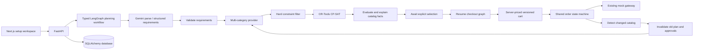

# IntentOS Phase 2

## Implemented

Phase 2 extends the existing application rather than replacing Phase 1. The original laptop request page, Gemini integration, ranking engine, purchase sessions and `/api/v1/purchases/*` endpoints remain. The shared order approval, mock gateway, payment records and audit events now also serve multi-item orders.

The new [setup workspace](http://127.0.0.1:3000/setup) supports laptop, monitor, keyboard, mouse and headphones, with required/optional categories, quantities, hard specifications, soft preferences, category priorities and global spending preferences. The catalog contains 46 clearly marked demo configurations: 22 laptops and six products per accessory category. Synthetic performance and quality scores are not measured benchmarks.

Natural-language mode uses Gemini's official structured-output SDK. Structured-input mode is explicitly labelled and goes directly to deterministic planning without claiming AI extraction. Missing API configuration produces a transparent error. No LLM can approve or execute a payment.

## Upgrade and run

Use the existing environment configuration from the root README. From the repository root:

```powershell
.\.venv\Scripts\python -m pip install -r backend/requirements.lock.txt
Set-Location backend
..\.venv\Scripts\python -m alembic upgrade head
..\.venv\Scripts\python -m app.services.catalog
..\.venv\Scripts\python -m uvicorn app.main:app --host 127.0.0.1 --port 8000
```

In a second terminal from the repository root:

```powershell
Set-Location frontend
npm ci
npm run dev
```

Open `/setup` for multi-product planning or `/` for the preserved single-product workflow. Set `GEMINI_API_KEY` only in the ignored backend environment file. PostgreSQL configuration and Docker Compose remain unchanged. A local SQLite database is supported for development by setting `$env:DATABASE_URL="sqlite:///./intentos.db"` before migration and startup.

For a previous seed, the seed command fills missing metadata and adds accessories without overwriting edited prices or availability. Existing records are not reset by reseeding. Run destructive experiments only in a separate disposable demo database, such as the browser-verification database created during development.

## Architecture and persistent state



`PurchasePlan` stores the typed graph state as JSON, original session ID, intent, alternative combinations, revision, parent plan and change explanations. The selection boundary is persisted in the database and resumed through a separate checkout graph. This is an explicit application-managed persistence boundary; it is not a claim of native LangGraph interrupt/checkpointer integration or a background worker.

The workflow records parse, validate, discover, filter, optimize, evaluate, explain, await-selection and prepare-checkout stages. Progress shows completed backend stages, not simulated live streaming. Replanning rediscoveries use the provider interface and the already-confirmed structured intent; budget or preference changes may supply a validated replacement intent.

## Mathematical optimization

Implementation: `backend/app/services/budget_optimizer.py`, using [Google OR-Tools CP-SAT](https://developers.google.com/optimization/cp/cp_solver/).

For each eligible product p and unit k, define a binary decision variable x[p,k]. Unit prefixes satisfy `x[p,k+1] <= x[p,k]`, eliminating interchangeable-unit symmetry. Each category can select multiple units of one SKU or a mix of eligible SKUs, bounded by catalog stock and requested quantity.

Constraints:

- Required category c: sum of selected units in c equals requested quantity q[c].
- Optional category c: sum equals q[c] × y[c], where y[c] is binary. Optional quantities are all-or-none.
- Sum of integer INR prices of selected units is at most total budget B.
- Ineligible products have no decision variables: availability, seller availability, currency, positive price, stock and all hard specifications must pass first.

Each selected unit contributes integer utility:

```text
u[p] = round(10000 × category_priority × weighted_normalized_components)
       - round(10000 × savings_weight × price[p] / B)
```

Components are demo performance, demo quality, portability `1/(1+kg)`, battery estimate capped at 24 hours, quality/price normalized against the best eligible ratio in that category, and the fraction of satisfied soft preferences. Missing battery specifications remove the battery weight. Empty soft preferences use a neutral 0.5 component. Global weights and category priorities come from the validated intent. Savings preference increases the savings penalty; quality preference reduces it.

The objective maximizes `(B+1) × sum(u[p] × x[p,k]) − total_cost`, so one integer utility unit dominates any secondary cost difference. Fixed candidate ordering, one solver worker and random seed zero make the tested cases reproducible. Each solve has a five-second limit; `FEASIBLE` is disclosed separately from proven `OPTIMAL`. A limit without a feasible incumbent returns `SOLVER_LIMIT`, not a fabricated optimum.

Up to three distinct combinations are generated with exact no-good cuts over the prior selected binary vector. Results include unit snapshots, quantities, total/remaining budget, utility, category spending, omitted optional categories, grounded reasons and solver status. Utility is context-dependent: normalization can change after catalog changes, so comparing old/revised scores is not a real-world performance claim.

## Checkout, revisions and approval safety

- Carts contain server-produced item snapshots and a version. Editing submits product IDs only; the backend validates category counts, stock, hard constraints and budget again. Old versions receive 409.
- Order creation snapshots product, seller, quantity and unit price in `order_items`. One cart can create one order. The existing payment and audit tables remain authoritative.
- Approve/pay recheck the selected catalog records. Price increases **and decreases**, seller/product unavailability, insufficient stock and changed specifications block checkout.
- A stale multi-product plan is marked `INVALIDATED`. Its carts become `STALE`; unpaid orders become `CANCELLED` with `APPROVAL_INVALIDATED` audit events.
- The backend automatically generates a revised plan with parent ID and revision, changed products and totals. The conflict response contains `revised_plan_id`. The UI offers review rather than silently replacing the cart.
- The revised plan requires a new cart, new pending order and fresh explicit approval. Paid historical orders are never cancelled or rewritten by replanning.
- Budget/preference changes trigger the same invalidation path. Failed payments remain terminal; preparing a new cart is deliberate and does not automatically approve it.
- Repeated requests use the existing idempotency protections and one-payment-per-order constraint. Same-key retries return the stored transaction; conflicting keys fail.
- Single-product stale approvals also now cancel rather than remaining visually approved.

Order IDs associated with a plan are returned from the database so reopening a saved plan restores the persisted order and transaction. Recent plan shortcuts live in browser storage; the transaction itself does not.

## Database migration

`backend/migrations/versions/0002_multi_commerce.py` adds:

- `purchase_plans`: versioned intent, results and persisted workflow state.
- `carts`: selected alternative, item snapshot, version and lifecycle state.
- `order_items`: per-item quantity, unit price, seller and product snapshot.
- Nullable unique `orders.cart_id` and nullable legacy `orders.product_id` for bundle orders.

Legacy order IDs, amounts, payments and audit events are retained. Automated migration testing creates a paid Phase 1 order, upgrades it and verifies its fields. Downgrade works when no multi-item orders exist and refuses to erase multi-item financial history. PostgreSQL execution and concurrency remain unverified in this environment; the migration and runtime tests ran with SQLite.

## API additions

All paths below are under `/api/v1`. Existing Phase 1 paths are preserved.

| Method | Path | Input / result |
| --- | --- | --- |
| GET | `/catalog?category=monitor` | Multi-category demo catalog; omit category for all |
| POST | `/multi/analyze` | `{text}` → Gemini interpretation and persisted plan |
| POST | `/plans` | `{intent}` → persisted plan from explicit structured input |
| POST | `/optimization` | `{intent}` → stateless CP-SAT result |
| GET | `/plans/{id}` | Plan, alternatives, revision, graph state, associated order IDs |
| GET | `/plans/{id}/alternatives` | Distinct purchase combinations |
| POST | `/plans/{id}/validate` | `{}` → freshness check, automatic revised plan if stale |
| POST | `/plans/{id}/replan` | `{intent?: ...}` → rediscover, optimize and invalidate old approval |
| POST | `/plans/{id}/simulate-change` | `{product_id, change}` → mutate a demo record |
| POST | `/carts` | `{plan_id, alternative_index}` → server-priced cart |
| GET | `/carts/{id}` | Persisted cart and version |
| POST | `/carts/{id}/items` | `{product_ids, expected_version}` → validated replacement cart |
| POST | `/multi/orders` | `{cart_id, cart_version, idempotency_key}` → pending order |
| POST | `/orders/{id}/approve` | Existing `{approved:true}` endpoint, now supports bundles |
| POST | `/orders/{id}/pay` | Existing mock-payment endpoint, now supports bundles |
| GET | `/orders/{id}` | Existing endpoint includes item snapshots and persisted payment |
| GET | `/orders/{id}/events` | Existing audit history endpoint |

The simulator is limited to demo products selected by the plan and supports `unavailable`, `seller_unavailable`, `price_increase` and `price_decrease` (INR 1,000 deltas). It changes the local demo catalog; freshness checks and checkout detect the change. This is a local demo tool, not a merchant integration.

## Actual verification

See [the generated benchmark report](benchmarks/phase2.md) and [raw measurements](benchmarks/phase2.json). The 52 checked-in scenarios cover single and multi-product requests, feasible hard specifications, optional items, quantities, strict/impossible budgets, conflicts, missing input, stock availability, price changes, sellers, budget/preferences replanning and payment failure.

```powershell
# Repository root
$env:DATABASE_URL="sqlite://"
.\.venv\Scripts\python -m pytest -q
npm --prefix frontend run typecheck
npm --prefix frontend run build

# Evaluation report regeneration
Set-Location backend
..\.venv\Scripts\python -m app.evaluation
```

The suite mocks Gemini responses, while executing the actual LangGraph, CP-SAT, API, database and mock-payment code. The cheapest-item baseline independently selects cheapest eligible units in each required category and omits optional items; both systems are evaluated using the same utility function and initial catalog snapshot. Timings exclude database fixture setup and live model latency and are not production benchmarks.

Browser verification used explicit structured input against real backend/database code: a selected laptop became unavailable after approval, payment was blocked, the previous order was cancelled, a revised cart required fresh approval, and its simulated payment and audit history were persisted. Reopening the saved plan restored the transaction. Live Gemini acceptance still needs an API key.

## Final measured results

- Full regression suite: **97 tests passed**, with 14 upstream Python deprecation warnings.
- TypeScript check and Next.js production build: **passed**, preserving `/` and adding `/setup`.
- Evaluation scenarios: **52/52 passed**.
- Budget compliance and hard-constraint satisfaction: **64/64 checked plans**.
- Expected outcomes: **40 READY, 8 INFEASIBLE, 4 NEEDS_DETAILS**.
- Replanning: **24/24 flows passed**; payment workflow: **40/40 expected outcomes passed**, including deliberate failure simulation.
- Mean optimized utility: **104,138.225**, versus **83,944.875** for the cheapest-item baseline, across 40 comparable scenarios.
- Mean local execution: **99.830 ms**; p95: **155.490 ms**. These exclude live Gemini latency and database fixture construction.
- Live Gemini and PostgreSQL acceptance/concurrency: **not run**, because a Gemini key and Docker/PostgreSQL service were unavailable.

## Remaining issues and recommended next milestone

No real merchant API, inventory reservation, real payment gateway or multi-user authentication is included. All server binds should remain on loopback. CORS does not provide authorization. Catalog prices, quality scores and specifications remain synthetic. Structured interpretation can still misunderstand ambiguous user language; review extracted requirements before approving.

The next milestone should add authenticated ownership, PostgreSQL integration/concurrency tests, provider refresh/versioning and inventory reservations before considering external payment integration. Native LangGraph durable checkpoints, background execution, cancellation, provider retries and multi-merchant reconciliation can follow. Real payments would require gateway-level idempotency, an outbox, webhook verification and reconciliation rather than a network call inside a database transaction.

## Phase 2 files changed or added

```text
README.md
backend/alembic.ini
backend/app/agents/multi_workflow.py
backend/app/api/multi_routes.py
backend/app/api/routes.py
backend/app/evaluation.py
backend/app/main.py
backend/app/models/entities.py
backend/app/models/multi_schemas.py
backend/app/models/schemas.py
backend/app/services/budget_optimizer.py
backend/app/services/bundle_checkout.py
backend/app/services/catalog.py
backend/app/services/gemini.py
backend/app/services/optimization.py
backend/app/services/orders.py
backend/app/services/plans.py
backend/data/accessories.json
backend/data/laptops.json
backend/evaluations/scenarios.json
backend/migrations/versions/0002_multi_commerce.py
backend/requirements.lock.txt
backend/requirements.txt
backend/tests/test_api.py
backend/tests/test_evaluation.py
backend/tests/test_gemini.py
backend/tests/test_migrations.py
backend/tests/test_multi_api.py
backend/tests/test_multi_schema.py
backend/tests/test_optimizer.py
backend/tests/test_plans.py
backend/tests/test_workflow.py
docs/IMPLEMENTATION.md
docs/PHASE2.md
docs/benchmarks/phase2.json
docs/benchmarks/phase2.md
frontend/src/app/globals.css
frontend/src/app/page.tsx
frontend/src/app/setup/page.tsx
frontend/src/components/BudgetAllocation.tsx
frontend/src/components/MultiWorkspace.tsx
frontend/src/components/PlanCart.tsx
frontend/src/lib/api.ts
frontend/src/lib/multi.ts
```
