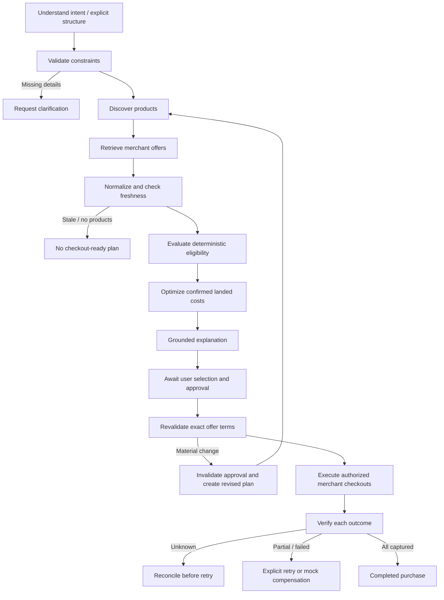

# IntentOS Phase 3 — Commerce intelligence and payment orchestration

## Delivery and verified scope

Phase 3 extends the existing repository. The original `/` laptop agent and `/setup` multi-product workspace, their APIs, CP-SAT optimizer, plan records, orders, payments and migrations remain. The starting regression suite had 97 passing tests. The new `/commerce` workspace adds offer-level costs, persisted research/session memory, merchant-specific suborders and reconciliation-aware mock execution.

**No live shopping integration, real merchant checkout, sandbox payment adapter or real-money execution is configured or claimed.** The live-provider interface is implemented, but an authorized API, official adapter and credentials are still required. The core application runs with actual backend logic against clearly marked demo offers. Gemini is genuinely integrated through the existing official SDK; live model calls still need your local API key.

## Run or upgrade on Windows PowerShell

From the repository root:

```powershell
.\.venv\Scripts\python -m pip install -r backend/requirements.lock.txt
docker compose up -d db
Set-Location backend
# Copy .env.example to .env only if you have not already configured it.
..\.venv\Scripts\python -m alembic upgrade head
..\.venv\Scripts\python -m app.services.catalog
..\.venv\Scripts\python -m uvicorn app.main:app --host 127.0.0.1 --port 8000
```

In a second terminal, starting at the repository root:

```powershell
Set-Location frontend
npm ci
npm run dev
```

Open [the commerce workspace](http://127.0.0.1:3000/commerce). The original pages remain at `/` and `/setup`. When port 8000 is occupied, use `--port 8010`, set `NEXT_PUBLIC_API_URL=http://127.0.0.1:8010` in the ignored frontend environment file and restart Next.js.

Docker/PostgreSQL were unavailable in this development environment. Local demonstration/testing can instead set `$env:DATABASE_URL="sqlite:///./intentos.db"` in the backend terminal before migration/startup. The browser verification used a separate ignored `phase3-preview.db`; no existing user database was reset. The seed command preserves edited catalog prices and availability.

Natural-language research, preference updates and grounded explanation selection require `GEMINI_API_KEY` in the ignored `backend/.env`. Explicit structured-input controls work without it and do not claim AI extraction. Keep `PAYMENT_MODE=mock`; unsupported payment modes do not activate a nonexistent real adapter.

## Provider architecture and provenance

`backend/app/commerce/providers.py` supplies the abstract `ProductProvider`, `ExternalCommerceProvider` revalidation contract, functional `DemoCatalogProvider` and `ProviderRegistry`. The registry normalizes results, isolates provider failures, rejects provenance mismatches and conflicting globally unique offer IDs, and deduplicates exact product configurations.

`ProductNormalizationService` separates a canonical product's brand/model/category/specifications from its merchant offers. `ProductDeduplicationService` uses normalized brand/model/category plus the full specification configuration: differing RAM/storage variants are never fuzzy-merged. Conflicting reuse of a product ID is rejected rather than silently changing specifications. Future external adapters must namespace their identifiers and provide official documentation metadata before asserting authorized live provenance.

The persisted catalog has 46 demo configurations and produces two demo merchant offers per product, distributed across three demonstration merchants. Initial offer discovery persists the quotes; subsequent discovery retains their terms rather than resetting edited offers or extending validity implicitly. Merchant availability is authoritative across that merchant's offers. Discovery never promotes demo records to live results.

Source distinctions:

| Source | Meaning | Checkout policy |
| --- | --- | --- |
| `demo` | Local synthetic offer, explicitly labelled demo | Allowed only as mock checkout |
| `live_verified` | Reserved for authorized provider-verified responses | Requires trusted adapter registration and freshness; none currently configured |
| `cached` | Historical external information | Excluded until revalidated |
| `unverified` | Unverified external information | Excluded |

Freshness is bounded by the earlier of explicit expiry and 15 minutes from retrieval. Future-dated, expired, unavailable, out-of-stock, cached or unverified offers cannot enter checkout eligibility. Demo refresh explicitly re-quotes the local stored terms with new timestamps; it is not represented as live merchant verification. Old expired approvals still require a new plan and approval.

## Exact total-cost calculation and optimization

All Phase 3 monetary inputs are Decimal strings or integers; binary float money, non-finite amounts, negatives and fractional paise are rejected. API monetary outputs are decimal strings. The frontend formats those strings without monetary arithmetic. Legacy Phase 1/2 integer-INR contracts are retained unchanged.

For each unit of an offer:

```text
confirmed discount = min(base price, sum(active verified eligible discounts))
final cost = base price - confirmed discount + shipping + fees + supported estimated taxes
```

Potential, expired, ineligible or unverified discounts are disclosed but not deducted. Unsupported taxes are not invented or presented as tax-free; the UI labels them as not supplied. Shipping and fees are explicitly per unit. Basket thresholds, bank offers, coupons, delivery guarantees, tax jurisdictions and shipping consolidations are not inferred.

The actual OR-Tools CP-SAT model selects offer/unit binary variables, enforces required and optional category quantities, hard specifications, seller restrictions, currency, stock and total budget, and maximizes integer weighted utility with lower-cost tie-breaking. Prices are converted from Decimal to integer paise; no financial float arithmetic enters the model. Duplicate listings do not multiply stock for the same product/merchant, while distinct merchants can supply distinct units. Category priorities and soft weights come from the validated intent.

The utility model extends the existing performance, quality, portability, battery, value, preference and savings components. Quality/price normalization handles zero-quality scores safely. Up to three distinct alternatives are generated with no-good cuts. Each result contains selected merchant offers, quantities, full cost components, confirmed and potential discounts, remaining budget, merchant totals and solver status. The solver uses one worker and a fixed seed. A five-second per-solve bound means `FEASIBLE` is disclosed separately from a proven `OPTIMAL` result.

Implementation reference: [Google's CP-SAT integer-model documentation](https://developers.google.com/optimization/cp/cp_solver). Scores are synthetic heuristic utility units, not verified product benchmarks or claimed real-world savings.

## Persisted agentic workflow



Planning nodes save typed JSON state and completed-node checkpoints after execution. Interrupted planning can resume without rerunning completed nodes. The separate LangGraph checkout workflow persists approval checks, revalidation, execution and result verification, with conditional reconciliation/failure paths. This uses application-managed SQLAlchemy checkpoints and durable financial attempt records; it is not a claim of a native LangGraph checkpointer, background queue or continuously running autonomous watcher.

Gemini interprets initial intent and text preference patches. It may choose only enumerated catalog-backed explanation reasons; deterministic services render the exact facts. No LLM response can change a computed price, override eligibility, supply a payment amount or execute a payment. Structured input uses a transparent deterministic explanation path.

## Session memory and replanning

Each commerce session has its own current intent, relevant conversation, expected version and plan history. Patches merge by category and constraint field/operator. Omitted fields retain the existing budget and requirements; deleting a category or constraint requires an explicit removal. Vague 'lighter' preferences can raise portability weight without inventing a hard numeric weight cutoff. Session-version conflicts return 409.

New preferences create a parent-linked plan version and invalidate prior unpaid approval. A failed model call leaves an interrupted plan/session that can be inspected and resumed. No global preference singleton is shared across sessions.

Checkout compares the selected immutable snapshot with current offer/product/merchant terms. Price increases **and decreases**, shipping/fee/discount changes, merchant changes/unavailability, currency or identity changes, out-of-stock offers, expiry and changed specifications invalidate the old approval. Replanning searches current eligible offers and returns a `revised_plan_id` instead of silently switching merchant/product/amount.

After a partial or unknown financial outcome, replacement purchase creation is blocked until the prior exposure is reconciled or compensated. Paid historical purchases are never rewritten by replanning. An already in-flight provider operation cannot be assumed cancelled by a preference update; its definitive result must still be reconciled.

## Payment orchestration and saga behavior

The interfaces/services are `PaymentProvider`, `MockPaymentProvider`, `PaymentIntentService`, `PaymentAuthorizationService`, `PaymentExecutionService` and `PaymentReconciliationService`.

- A parent purchase creates separate merchant suborders and payment intents from server-side snapshots.
- One explicit approval covers every merchant, product, quantity and amount. An authorization digest protects the exact immutable snapshot, and intent/suborder/parent amounts are verified server-side.
- A durable attempt is committed **before** provider dispatch. The mock provider has its own durable receipt ledger and idempotency key. It does not collect credentials or transfer real money.
- `PROCESSING` after interruption and all transport timeouts are treated as unknown, not failed. A captured-but-timed-out mock receipt is recovered by reconciliation without another charge.
- Reconciliation reads the provider ledger and verifies the amount before accepting an outcome. A missing, mismatched or unresolved result remains unknown. Demo outcome simulation cannot overwrite a definitive contradictory provider receipt.
- Initial batch retries reuse the parent execution key and original modes. Captured/failed attempts are not silently repeated; only remaining unattempted authorized suborders can resume.
- Explicit retries require a definitive failure, unchanged approved terms, elapsed two-second backoff and fewer than three total attempts per intent. Unknown payments must reconcile first. A crash/reconciliation fences an old worker with an execution token so a late result cannot dispatch additional merchant charges.
- Merchant outcomes are tracked individually. A subset captured is `PARTIAL_FAILURE`, not `PAID`. An unknown suborder makes the parent `PAYMENT_UNKNOWN`; success requires all suborders captured.
- Compensation is an explicit saga step. Known captured mock receipts can become `REFUND_PENDING` or `REFUNDED`; pending refunds retain captured exposure and are not counted as refunded. Unknown charges cannot be blindly compensated. `COMPENSATED` is distinct from successful purchase completion.

The mock receipt ledger is a local provider simulation, not an independently operated payment processor. These safeguards are production-inspired; PostgreSQL concurrent-worker behavior, distributed delivery, authenticated webhooks, network retries and real refund semantics have not been verified. No real refund is asserted to be immediate or guaranteed.

## Observability

The developer trace stores workflow/session IDs, actual node/tool execution, provider counts, node/optimization/LLM duration, token usage when Gemini returns it, attempt numbers, payment transitions, reconciliation, compensation and error types. Missing token metadata is not invented.

Trace details use an explicit allowlist. Prompts, response bodies, API keys, credentials and payment instruments are excluded. Relevant user text remains in its own session conversation rather than developer traces. UTC offsets are emitted explicitly for traces, legacy audit events and retry deadlines, including SQLite timestamps that lose timezone metadata.

## Database migrations

Both migrations are additive and retain legacy tables/records:

- `0003_commerce_orchestration.py`: merchants, product offers, commerce sessions/plans, offer snapshots, parent purchases, merchant suborders, payment intents, attempts, mock provider receipts, reconciliation records and workflow traces.
- `0004_payment_authorization.py`: authorization digest, execution fencing token and persisted checkout workflow state on commerce purchases.

Downgrade refuses to discard commerce purchase/payment history. Migration tests retain a paid Phase 1 order through upgrade/downgrade/re-upgrade. Runtime tests use isolated SQLite databases. PostgreSQL is still the intended production database; run migration and concurrency tests there before external deployment.

## API additions

All paths are prefixed `/api/v1/commerce`; the prior APIs remain available.

| Method | Path | Purpose |
| --- | --- | --- |
| GET | `/providers` | Actual demo/mock configuration and explicit pending live/sandbox status |
| GET | `/offers?category=laptop` | Normalized products, merchant quotes, cost breakdowns and freshness |
| POST | `/offers/refresh` | `{offer_ids:[]}`; refresh local demo quote timestamps only |
| POST | `/sessions` | Exactly one of `{text}` or `{intent}`; persist research and plan |
| GET | `/sessions/{id}` | Context, conversation and plan versions |
| POST | `/sessions/{id}/preferences` | `{expected_version, text}` or `{expected_version, patch}` |
| GET | `/plans/{id}` | Persisted result, snapshots, workflow and purchase IDs |
| POST | `/plans/{id}/resume` | Resume interrupted planning; stale versions cannot supersede newer context |
| POST | `/plans/{id}/replan` | Rediscover and create a new plan version |
| POST | `/plans/{id}/validate?alternative_index=0` | Revalidate selected terms; 409 includes revised plan when needed |
| POST | `/purchases` | `{plan_id, alternative_index, idempotency_key}`; server-priced merchant orders/intents |
| GET | `/purchases/{id}` | Parent, merchant outcomes, attempts, captured/refunded totals and workflow |
| POST | `/purchases/{id}/approve` | `{approved:true}` for the exact complete terms |
| POST | `/purchases/{id}/reject` | Reject before execution |
| POST | `/purchases/{id}/execute` | `{idempotency_key, simulations:{merchant_id:mode}}`; authorized mock checkout |
| POST | `/purchases/{id}/reconcile` | Read mock provider outcomes; does not retry charges |
| POST | `/suborders/{id}/retry` | Explicit bounded retry of confirmed failure |
| POST | `/purchases/{id}/compensate` | `{pending:false}`; explicit mock saga reversal |
| POST | `/demo/attempts/{id}/resolve` | Record a mock unknown outcome before reconciliation |
| POST | `/demo/offers/change` | Demo price/stock/merchant/expiry changes |
| GET | `/sessions/{id}/traces` | Redacted structured execution history |

Execution modes are `success`, `failure`, `timeout_captured`, `timeout_unknown` and `checkout_failure`. They are simulation controls, not real provider behavior. Unknown merchants, client payment amounts, conflicting idempotency inputs and invalid state transitions are rejected.

## Verification and acceptance

See [the machine-readable validation record](validation/phase3.json) for final executed counts. The suite retains the original Phase 1/2 tests and their 52 reproducible evaluations. New tests cover normalization, deduplication, provenance, exact costs/discounts/taxes, expiry, stock/quantities, merchant optimization, isolated memory merging, versioning/resume, approval invalidation, idempotency, unknown outcomes, reconciliation amount mismatches, bounded retry, worker fencing, partial failures, compensation exposure and trace redaction.

```powershell
# Repository root
$env:DATABASE_URL="sqlite://"
.\.venv\Scripts\python -m pytest -q
npm --prefix frontend run typecheck
npm --prefix frontend run build
```

Browser acceptance used explicit structured inputs against actual backend/database code, not mocked frontend results:

- A complete demo setup was optimized to INR 90,263.75 across three merchants, with shipping, fees and confirmed demo rebates included and potential discounts excluded.
- Two merchant payments captured and one definitively failed. The parent accurately showed `PARTIAL_FAILURE`, with INR 26,096.25 captured.
- Pending compensation retained that exposure; confirmed mock reversals produced `COMPENSATED`, zero captured balance and INR 26,096.25 mock-refunded.
- A lighter-preference patch retained the INR 100,000 budget and all five required categories while increasing portability weight from 1 to 5.
- Increasing the selected offer by INR 4,000 triggered a new plan version that selected an alternative merchant behind a fresh approval barrier.

Live Gemini acceptance, live merchant APIs, real/sandbox payment execution and PostgreSQL concurrency are **not verified**. No benchmark improvement over Phase 2 is claimed; domain coverage and test counts changed, so test runtime is not a comparative performance benchmark.

## Final validation results

- **141 tests passed**, zero failures/errors/skips; 44 additional tests beyond the 97-test Phase 2 baseline.
- **14 upstream deprecation warnings** remain in LangSmith/Google SDK internals on Python 3.14.
- **TypeScript check passed** and **Next.js production build passed** for `/`, `/setup` and `/commerce`.
- Migration upgrade/downgrade/re-upgrade and preservation of a paid legacy order passed with SQLite.
- Browser acceptance confirmed demo provenance, landed-cost optimization, partial merchant outcomes, pending/confirmed mock compensation, session preference retention and alternative-merchant replanning.
- Live Gemini, authorized merchant/sandbox adapters, real-money transactions and PostgreSQL concurrent workers remain unverified.

The test-runner duration is recorded for reproducibility, not as a benchmark improvement over previous phases. The raw XML remains local/ignored; the committed summary omits host identifiers and captured output.

## Remaining setup and Phase 4

The application remains a single-user local demo with no multi-user authentication or authorization. Session IDs isolate context but are not access credentials. Keep servers on loopback; CORS is not authentication. Do not publish payment/demo-mutation endpoints publicly.

Phase 4 should prioritize authenticated ownership, PostgreSQL integration/concurrency tests, native durable checkpoints or a transactional job queue/outbox, inventory reservations, actual provider refresh contracts, and a provider sandbox backed by official documentation and authorized credentials. Real gateways would additionally need signed webhooks, ledger reconciliation, refund handling, operational monitoring and independently verified idempotency semantics.

## Phase 3 files created or modified

```text
.gitignore
README.md
backend/app/api/commerce_routes.py
backend/app/api/routes.py
backend/app/commerce/__init__.py
backend/app/commerce/ai.py
backend/app/commerce/checkout.py
backend/app/commerce/execution_workflow.py
backend/app/commerce/freshness.py
backend/app/commerce/normalization.py
backend/app/commerce/optimizer.py
backend/app/commerce/payment_providers.py
backend/app/commerce/payments.py
backend/app/commerce/pricing.py
backend/app/commerce/providers.py
backend/app/commerce/schemas.py
backend/app/commerce/sessions.py
backend/app/commerce/store.py
backend/app/commerce/tracing.py
backend/app/commerce/workflow.py
backend/app/core/time.py
backend/app/main.py
backend/app/models/commerce.py
backend/app/models/entities.py
backend/app/services/gemini.py
backend/migrations/versions/0003_commerce_orchestration.py
backend/migrations/versions/0004_payment_authorization.py
backend/tests/test_commerce_api.py
backend/tests/test_commerce_offers.py
backend/tests/test_commerce_payments.py
backend/tests/test_commerce_workflow.py
backend/tests/test_offer_optimizer.py
backend/tests/test_time.py
docs/IMPLEMENTATION.md
docs/PHASE3.md
docs/PHASE3_PLAN.md
docs/validation/phase3.json
frontend/src/app/commerce/page.tsx
frontend/src/app/globals.css
frontend/src/app/page.tsx
frontend/src/components/CommercePlanPanel.tsx
frontend/src/components/CommerceWorkspace.tsx
frontend/src/components/MerchantPayments.tsx
frontend/src/components/MultiWorkspace.tsx
frontend/src/components/OfferComparison.tsx
frontend/src/lib/commerce.ts
```
