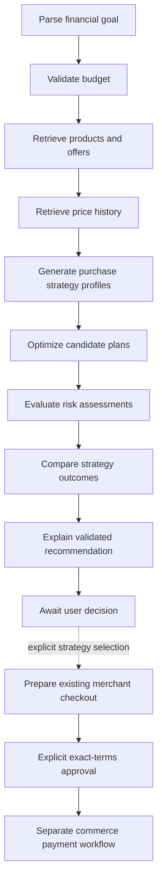

# Phase 4: financial decision intelligence

IntentOS now compares purchase strategies under a protected reserve, category caps and explicit risk preferences. Open `/finance`. Prices and merchants remain **demo data**, and payments remain **mock**. No real-world savings or price forecasts are claimed.

## Verified starting point

Development continued from `f3463b3` on the existing `master` branch, with a clean working tree, the configured Samaira Sharma Git identity and the existing `origin` remote. The baseline passed **141 backend tests**, TypeScript checking and a Next.js production build.

The audit verified the existing Gemini official SDK wrapper, OR-Tools integer-cost optimizer, persistent commerce LangGraph, normalized offer provenance, quote freshness checks, exact-terms approval digests, execution fencing, independent mock receipt ledger, reconciliation, explicit retry and compensation paths. Existing API tests exercise these paths with fixture AI and isolated SQLite. Migrations preserve legacy paid orders through upgrade/downgrade/re-upgrade.

Live merchant adapters, a sandbox payment integration, real Gemini calls without configured credentials, PostgreSQL runtime verification and production authentication were not available for this acceptance run. They are not represented as completed integrations. Docker was unavailable in the development environment.

## Financial constraints and strategies

All money enters as integer rupees or decimal strings with at most two decimal places. Binary float money, negative money and non-finite values are rejected. Deterministic calculations use `Decimal`; CP-SAT receives integer paise. Financial budgets are limited to INR 10,000,000.

```
spendable = total available - mandatory reserve
new purchase capacity = max(0, spendable - existing commitments)
category capacity = max(0, category limit - category commitments)
```

The existing optimizer accepts additional hard capacity and category limits. It retains required quantities, all-or-none optional categories, priorities, hard specifications, merchant filters, inventory limits and landed costs. Reserve money is never an optimization variable. A non-integer rupee capacity is enforced in exact paise even though the legacy commerce intent has a whole-rupee budget field.

Current strategies are:

| Strategy | Deterministic behavior |
|---|---|
| Immediate baseline | Existing utility objective without risk penalties, under the same hard financial constraints |
| Lowest-price baseline | Minimize landed cost under those constraints; optional categories may be omitted |
| Optimized | Apply the selected cost-focused, balanced or risk-averse objective |
| Essentials now | When both required and optional categories exist, buy only explicitly required categories; optional categories need a later decision |
| Wait | Non-executable conditional historical comparison, or an explicit insufficient-evidence / waiting-not-permitted result |

All immediate strategies reallocate spend among eligible products subject to the user's priorities and caps. They are alternatives, not additive orders. The optimized current basket is the recommendation when feasible. Waiting is never automatically preferred using an assumed future discount; a conditional target is advisory and cannot enter checkout.

Existing pending/authorized purchases and captured, processing, unknown or refund-pending suborders encumber the financial session's envelope. Cancelled, refunded and confirmed failed suborders do not. Replanning subtracts encumbered amounts and category costs. Creating, approving and executing another purchase rechecks this capacity. Requirements describe the next requested basket; previously purchased items are not automatically removed from a revised goal.

## Historical evidence

`price_observations` records product, merchant, offer, landed unit price, currency, observation timestamp, source, verification and observation kind. Landed unit price uses the existing total-cost service: base minus eligible verified discounts, plus shipping, fees and supported taxes. Potential discounts never reduce the cost.

Actual quote reads record `recorded_demo` or `recorded_live` according to provider provenance. Re-reading the same quote does not create another observation. A demo observation is still not a genuine market price. Observations are made when discovery reads quotes; there is no background market collector.

The explicit synthetic fixture endpoint creates 14 labeled daily points per offer. Fixture-v1 keys are immutable across repeated seeding and later quote edits. It does not backdate genuine observations. `recorded` excludes all synthetic samples; `synthetic_demo` uses only synthetic samples. The UI labels the source on the chart and every sample retains its provenance.

The 90-day history API returns observed minimum, maximum, arithmetic mean, last observed price change, population standard deviation, coefficient of variation and the current quote relative to the observed mean/minimum. SVG chart coordinates are calculated from those stored values. No chart is generated from an invented live price stream.

```
mean = sum(prices) / count
population standard deviation = sqrt(sum((price - mean)^2) / count)
volatility percent = 100 * standard deviation / mean
```

Historical comparison needs at least eight observations across seven distinct UTC dates spanning seven days. Otherwise the evaluator returns `INSUFFICIENT_EVIDENCE`. A single repeated quote cannot pass this gate.

Waiting must fit both patience and the explicit deadline. Its target is either the user's target or the sum of selected offers' observed minima. The latter assumes all those minima become simultaneously available, an assumption explicitly disclosed as potentially impossible. Net conditional difference is current basket cost minus target minus the user's daily opportunity cost multiplied by waiting days. Low current stock is flagged. No future probability, expected saving or guaranteed discount is estimated. Synthetic history supports only an illustrative conditional comparison.

## Documented risk policy

Risk indices are **policy penalties**, not confidence, merchant reputation, delivery promises or loss probabilities.

Offer risk v1:

- Volatility: `min(100, observed CV percent * 5)` when sufficient history exists; otherwise an explicit unknown-history penalty of 30.
- Provenance: 0 for verified live provenance, 35 for demo provenance. Cached/unverified offers are excluded from executable optimization by the existing freshness service.
- Quote age: `min(100, age_seconds / 9)`; the normal quote lifetime is 900 seconds.
- Stock scarcity: 70 at one or two units, 25 at three through nine, 0 at ten or more. This is an inventory proxy, not a stock-out forecast.
- Combined index: 30% volatility + 30% provenance + 20% quote age + 20% scarcity.

Basket risk is 70% cost-weighted offer index + 15% basket utilization of spendable budget + 15% largest merchant's basket share. Delivery risk is unavailable because the schema has no verified delivery observations. No seller reputation is invented.

The base utility remains the existing weighted product utility. Balanced subtracts 25 times the offer risk index per selected unit; risk-averse subtracts 500 times the index. Their CP-SAT objectives additionally penalize the largest seller spend with coefficients 1,000 and 10,000 respectively:

```
maximize adjusted_utility * (capacity_paise + 1)
         - landed_cost_paise - concentration_coefficient * largest_seller_spend_paise
```

Cost-focused directly minimizes landed cost. A deterministic fixture test confirms that a slightly cheaper demo offer wins cost-focused planning while a slightly more expensive verified-provenance fixture wins risk-averse planning. These mocked provenance inputs do not imply a deployed live merchant integration.

## Persistent LangGraph and approval boundary



Each financial graph node commits JSON state and its completed-node marker to the decision record. Resume skips completed nodes. An AI outage leaves an `INTERRUPTED` decision ID that can be resumed after configuration is corrected. The offer snapshot and clock are persisted for reproducible hypothetical replay.

Gemini interprets explicit natural-language requirements using the existing official SDK. For explanation it selects only validated reason IDs rendered by the backend from optimized facts. It cannot set the computed spendable amount, choose an infeasible basket, emit a forecast or authorize payment. Structured input works without a key and makes no AI-extraction claim.

Strategy selection creates a linked `CommercePlan` and a pending mock purchase. It does not approve or execute. Financial links bind checkout to the immutable financial decision. Existing commerce create/approve/execute/retry paths enforce its reserve and category policy; generic commerce preference/replan/resume endpoints cannot bypass the financial workflow.

A revised financial goal supersedes the prior decision, invalidates associated plans and cancels untouched pending/approved authorizations. Already captured or in-flight outcomes are retained and remain encumbered. Material quote/specification/stock changes create a revised financial decision and return HTTP 409 with `revised_decision_id`. The frontend restores the revision for review and requires fresh checkout and approval.

## What-if scenarios

Scenarios clone the persisted decision's offer snapshot. They never write merchant offers or price observations and never become executable strategies. Supported parameters:

```json
{
  "category_price_change_percent": {"laptop": "10"},
  "budget_reduction": "15000.00",
  "remove_categories": ["headphones"],
  "unavailable_product_ids": [],
  "wait_days": 14
}
```

Base-price percentages range from -100 through 500. Shipping, fees, supported taxes and discount terms remain fixed assumptions. A reduced budget below reserve returns an explicit infeasible result. Waiting uses historical evidence and does not manufacture a future quote. Each scenario is saved alongside its parameters and is clearly hypothetical.

## APIs and storage

New prefix: `/api/v1/finance`.

| Method | Path | Result |
|---|---|---|
| POST | `/decisions` | Structured `goal` or natural-language `text` |
| GET | `/decisions/{id}` | Goal, reserve, strategies, risks, history, workflow progress, saved scenarios and transaction IDs |
| POST | `/decisions/{id}/resume` | Resume persisted graph |
| POST | `/decisions/{id}/revise` | Full revised `goal`; invalidates prior authorizations |
| POST | `/decisions/{id}/replan` | Re-evaluate saved goal and invalidate prior authorizations |
| POST | `/decisions/{id}/select` | `strategy` plus `idempotency_key`; prepare pending checkout |
| POST | `/decisions/{id}/scenarios` | Persist hypothetical result |
| GET | `/history/{offer_id}?mode=recorded` | Price evidence; alternate mode `synthetic_demo` |
| POST | `/demo/synthetic-history` | Explicit, labeled fixture creation |

Approval, execution, reconciliation, retry and compensation use the existing `/api/v1/commerce` endpoints. The dashboard includes explicit demo quote refresh plus replan, because quotes expire after 15 minutes. Refresh is not live verification.

Migration **0005** adds `price_observations`, `financial_decisions`, `financial_plan_links`, `scenario_simulations`. A decision's JSON stores its reserve, strategy plans, risk assessments and workflow checkpoints together; money is serialized as decimal strings. Links bind immutable policy to checkout. Migration **0006** widens historical product references to the catalog's existing 64-character identifier type. Published earlier migrations were preserved. Destructive downgrade is blocked when evidence/decisions exist; the type downgrade blocks identifier truncation.

Main implementation files:

- `backend/app/finance/{schemas,history,engine,workflow,service,benchmark}.py`
- `backend/app/models/finance.py`, `backend/app/api/finance_routes.py`
- Existing commerce optimizer, discovery, session, checkout and authorization hooks
- `backend/migrations/versions/0005_financial_intelligence.py`, `0006_observation_product_identifier.py`
- `frontend/src/app/finance/page.tsx`, `frontend/src/components/FinancialWorkspace.tsx`, `frontend/src/lib/finance.ts`
- Existing page navigation and shared stylesheet
- Finance test modules, migration regression tests and `docs/benchmarks/phase4.{json,md}`

## Run and verify

Use the main README's normal environment setup. Upgrade before starting the backend:

```powershell
Set-Location backend
..\.venv\Scripts\python -m alembic upgrade head
..\.venv\Scripts\python -m app.services.catalog
..\.venv\Scripts\python -m uvicorn app.main:app --host 127.0.0.1 --port 8000
```

Start the frontend normally and open `/finance`. If port 8000 is occupied, use backend port 8010 and set `NEXT_PUBLIC_API_URL=http://127.0.0.1:8010` before starting or building Next.js. The browser acceptance run used an isolated ignored SQLite preview database on 8010.

```powershell
# Repository root
.\.venv\Scripts\python -m pytest -q
Set-Location frontend
npm run typecheck
npm run build

# Reproduce measured demo benchmark
Set-Location ../backend
$env:DATABASE_URL='sqlite://'
..\.venv\Scripts\python -m app.finance.benchmark
```

The benchmark uses a fixed explicit fixture clock, 18 scenarios and three strategies each, repeated for consistency, plus 10% laptop price-increase replans. See the [measured results](benchmarks/phase4.md) and [machine-readable report](benchmarks/phase4.json). Runtime is measured per three-strategy evaluation; it varies by machine. These costs are simulated comparisons, not real-world savings.

## Final verification and delivery

The final backend run passed **158 tests** in **75.82 seconds**. There were 14 dependency deprecation warnings, with no test failures. Frontend TypeScript checking and the production build passed, including generation of `/finance` alongside the existing three workspaces.

Acceptance coverage includes:

- INR 100,000 available with INR 10,000 protected; all executable strategies remain within INR 90,000 and category caps.
- Missing history produces an explicit insufficient-evidence response; synthetic and recorded histories stay separate.
- Exact hypothetical base-price arithmetic, budget reductions, removed categories, unavailable products and deadline/patience constraints.
- Material cost-focused versus risk-averse selections using clearly mocked provenance inputs.
- No payment attempts before approval; budget and quote changes invalidate old approvals and require a revised decision.
- Financial checkout cannot escape policy through the older commerce replan/preference APIs.
- Captured commitments reduce subsequent planning capacity; refund-pending and unknown outcomes remain encumbered.
- Interrupted Gemini parsing returns a restorable decision with a safe incomplete view, then resumes with a fixture service.
- Legacy paid-order preservation, financial model/migration alignment and evidence-protecting downgrade guards.

Browser checks exercised reserved-basket evaluation, saved-decision restoration, hypothetical price changes, checkout preparation, explicit mock approval, subsequent budget revision, approval invalidation, transaction refresh and labeled synthetic history charts. No browser console errors were observed during the inspected workflow. Preview servers were stopped after verification.

Measured benchmark: **18 scenarios, 54/54 feasible strategy comparisons, zero hard financial/specification violations, 18/18 consistent repeats and 18/18 feasible 10% laptop-price-increase replans**. Mean three-strategy comparison runtime in the committed report is **56.667 ms**. Runtime from the separate test run can differ. No real-world savings measurement was performed.

Meaningful milestones pushed to the existing remote during development:

| Commit | Milestone |
|---|---|
| `085fc3d` | Labeled price observations and persistent financial records |
| `d51decc` | Reserved-budget optimization, risk profiles and hypothetical evaluation |
| `14279ff` | Persistent financial workflow, APIs and checkout policy enforcement |
| `e391c68` | Existing-commitment capacity, immutable fixtures and migration preservation |
| `faea7e0` | Financial dashboard, approval controls and incomplete-decision recovery |
| `d32302d` | Reproducible benchmark source, test and measured reports |

This architecture/setup/verification documentation is delivered in a final separate documentation commit. All listed pushes were confirmed by Git. No empty commits, rewritten timestamps, force pushes, database files or environment secrets were used.

## Remaining boundaries

- This is a local, single-user demonstration. Authentication, tenant isolation and public hosting hardening remain required before deployment. SQLite row locks do not provide PostgreSQL concurrency guarantees; no multi-client production guarantee is claimed.
- Live merchant feeds, a scheduled historical collector, sandbox/real payment adapters, verified delivery evidence and real-world outcome evaluation remain unimplemented.
- Gemini live calls require a configured API key and external acceptance testing. The automated tests use fixtures and verify failure/resumption behavior.
- Waiting is advisory and conditional. There is no future-price model, probability calibration, autonomous delayed purchase scheduling or guaranteed savings.
- Reserves belong to a financial session, not a bank account or a global user wallet. Creating an independent session creates a separate planning envelope.
- What-if results replay the original decision snapshot and its original scope; they do not modify an approved purchase. Updated commitments require a fresh actual replan before checkout.
- A changed budget cannot undo already captured payments. Further purchasing is constrained and unknown/refund-pending amounts remain encumbered until resolved.
